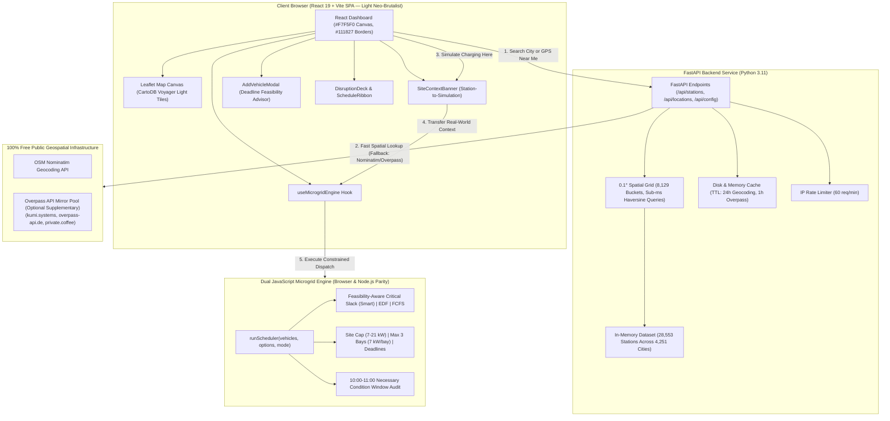

# GridSathi AI — EV Microgrid Scheduling & OpenStreetMap Discovery Platform

**HackWithAditya 2026 · Energy, EV & Sustainability Submission (Track 04)**<br>
*A disruption-aware, transparent EV charging orchestration and open discovery platform for power-constrained campuses and microgrids across India.*

**100% Free & Open-Source:** Built on Leaflet, OpenStreetMap, Nominatim, Overpass API, the Nationwide EV Charging Dataset (28,553 authentic stations across 4,251 cities under ODbL / CC-BY 4.0), React (Vite), and FastAPI. **Zero Google Cloud account, zero API keys, and zero payment credentials required.**

---

## 1. Requirements-to-Evidence Matrix (Hackathon Evaluation)

| Evaluation Criterion | Relevant Implemented Feature | Code Location | Verification Method | Implemented Status |
| :--- | :--- | :--- | :--- | :---: |
| **1. Innovation & Real-World Feasibility** | Combined nationwide EV discovery (28,553 stations) with transformer-constrained microgrid load scheduling; solar canopy integration and Station-to-Simulation hand-off (`SiteContextBanner`). | `backend/main.py`<br>`frontend/src/engine/microgridEngine.js`<br>`frontend/src/components/simulation/SiteContextBanner.jsx` | Run `node tests/benchmark_algorithms.js` to see real-time constraint enforcement. | **Complete** |
| **2. Algorithmic Correctness & Integrity** | Exact constraint enforcement: 7 kW bay limit, site transformer limit, energy conservation, deadline cutoffs, and Feasibility-Aware Critical Slack priority dispatch. | `tests/test_engine.js`<br>`tests/test_simulation_engine.js`<br>`frontend/src/engine/microgridEngine.js` | Run `node tests/test_simulation_engine.js` (96 scenarios pass with 100% dual-engine parity and 0 violations). | **Complete** |
| **3. Disruption Resilience & What-If Testing** | Real-time simulation of charger hardware faults (2 bays), grid brownouts (10 kW), emergency vehicle arrivals, and midday solar canopy generation (+4 kW boost). | `frontend/src/components/simulation/DisruptionDeck.jsx`<br>`frontend/src/components/simulation/ScheduleRibbon.jsx` | In UI, toggle disruptions in Disruption Deck and observe dynamic multi-track power re-allocation and shifted allocation rings without page reload. | **Complete** |
| **4. Transparency & Explainability** | Explicit demarcation of authentic OSM/dataset geospatial points vs simulated dispatch; mathematical necessary-condition window audits; Charging Deadline Feasibility Advisor. | `frontend/src/components/simulation/FeasibilityAudit.jsx`<br>`frontend/src/components/simulation/AddVehicleModal.jsx`<br>`frontend/src/components/StatusBanner.jsx` | Audit card computes 10:00–11:00 physical energy bounds vs heuristic outcomes; modal validates $E_{\text{req}} \le \Delta t \times P_{\max}$. | **Complete** |
| **5. Full-Stack Engineering Quality** | Asynchronous FastAPI service with 0.1° spatial grid indexing (8,129 buckets), light neo-brutalist React SPA with CartoDB Voyager tiles, and 23 backend unit tests. | `tests/test_backend.py`<br>`frontend/src/App.jsx`<br>`frontend/src/index.css` | Run `python -m unittest tests/test_backend.py` (23/23 pass) and `npm --prefix frontend run build` (clean Vite bundle in ~8s). | **Complete** |
| **6. Cloud Deployment Readiness** | Production CORS supporting Vercel preview regex (`https://.*\.vercel\.app`), `render.yaml` blueprint, `frontend/vercel.json` SPA routing rewrites. | `render.yaml`<br>`frontend/vercel.json`<br>`requirements.txt`<br>`backend/main.py` | Configuration files present and validated with zero secret exposure. | **Complete** |

---

## 2. Architecture & Data Flow



---

## 3. Mathematical Foundations & Algorithmic Dispatch

### A. Feasibility-Aware Critical Slack Formulation
At each 30-minute time slot $t \in \{0, 1, \dots, 9\}$, for each eligible vehicle $x$ with remaining demand $R_x(t)$, departure deadline slot $t_{\text{due}, x}$, and bay limit $P_{\text{bay}, x} = \min(P_{\max, x}, 7.0\text{ kW})$:

$$\Delta t = 0.5\text{ h}, \quad \text{SlotCapacity}_x = P_{\text{bay}, x} \times \Delta t = 3.5\text{ kWh}$$

$$\text{AvailableSlots}(x, t) = \max(1, t_{\text{due}, x} - t)$$

$$\text{MaxAchievable}_x(t) = \text{AvailableSlots}(x, t) \times \text{SlotCapacity}_x$$

$$\text{Slack}(x, t) = \text{MaxAchievable}_x(t) - R_x(t)$$

To prevent mathematically impossible requests (e.g., $15\text{ kWh}$ in $30\text{ minutes}$ at a $7\text{ kW}$ charger, where $\text{Slack} = -11.5\text{ kWh}$) from monopolizing charging bays and forcing feasible vehicles to miss their deadlines, GridSathi AI employs a **Three-Tier Critical Slack Priority Rule**:

1. **Group 0 (Critical Feasible — $0 \le \text{Slack} < \text{SlotCapacity}_x$):**
   The vehicle is physically capable of meeting its deadline under unconstrained maximum charging, but cannot skip the current slot without falling into an individual deficit. Sorted by least positive slack $\min \text{Slack}(x, t)$, then earliest deadline $t_{\text{due}, x}$.
2. **Group 1 (Imminent Deficit / Emergency Arrival — $\text{Slack} < 0$):**
   The vehicle's request exceeds physical charger capabilities even under continuous unconstrained power. Rather than discarding or starving the vehicle, it receives **best-effort partial charging** from available/slack power before its window closes, sorted by earliest departure $t_{\text{due}, x}$, then remaining deficit.
3. **Group 2 (Buffered Feasible — $\text{Slack} \ge \text{SlotCapacity}_x$):**
   The vehicle has at least one full 30-minute buffer slot of leeway under maximum power. It safely yields charging bays to urgent/emergency vehicles and completes charging in subsequent slots.

> [!NOTE]
> **Individual Feasibility vs. System Feasibility**:
> The critical-slack calculation evaluates **individual charging feasibility** under the optimistic assumption that maximum per-vehicle power ($\min(P_{\max, x}, 7.0\text{ kW})$) is available in every remaining slot until departure. However, in an operational microgrid:
> - **Shared Transformer Limits**: Total site load is bounded by transformer headroom ($P_{\text{grid\_limit}} + P_{\text{solar}}(t)$), which frequently throttles bay power.
> - **Bay Scarcity & Fleet Competition**: Limited bays ($B_{\max} \in \{2, 3\}$) and competing vehicles with overlapping departure windows mean power must be rationed.
> - **Partial-Power Allocation Limitations**: When an EV receives partial charging (e.g. $3\text{ kW}$ instead of $7\text{ kW}$) due to transformer capping, its remaining deficit compounds, which may still cause an individually feasible EV to miss its deadline.
>
> Consequently, this heuristic dynamically prioritizes urgency and protects feasible deadlines where possible, but does **NOT** guarantee deadline completion or globally optimal scheduling under severe resource congestion.

### B. Physical Microgrid Dispatch Constraints
At every time slot $t$:
1. **Per-Bay Limit**: $P_{x, b}(t) \le 7.0\text{ kW}, \quad \forall b \in \{1, \dots, B_{\max}\}$ (where $B_{\max} = 2$ under hardware fault, $3$ normally).
2. **Total Site Ceiling**: $\sum_{b=1}^{B_{\max}} P_{b}(t) \le P_{\text{grid\_limit}} + P_{\text{solar}}(t)$ (where $P_{\text{grid\_limit}} \in \{7, 10, 14, 21\}\text{ kW}$, capped at $10\text{ kW}$ under brownout, and $P_{\text{solar}}(t) \in [0, 4]\text{ kW}$).
3. **No Over-Delivery (First Law of Thermodynamics)**: $\sum_{t=0}^{t_{\text{due}, x}-1} P_x(t) \times 0.5\text{ h} \le E_{\text{requested}, x}$.
4. **Deadline Enforcement**: $P_x(t) = 0, \quad \forall t \ge t_{\text{due}, x}$.
5. **Bay Singularity**: Each vehicle occupies at most one bay per time slot: $\sum_{b=1}^{B_{\max}} \mathbb{I}(x \text{ assigned to } b) \le 1$.

### C. Jain's Fairness Index
To evaluate equitable power distribution across all fleet drivers:

$$J(x) = \frac{\left(\sum_{i=1}^{n} f_i\right)^2}{n \sum_{i=1}^{n} f_i^2}, \quad \text{where } f_i = \begin{cases} \frac{E_{\text{delivered}, i}}{E_{\text{requested}, i}} & \text{if } E_{\text{requested}, i} > 0 \\ 1.0 & \text{otherwise} \end{cases}$$

- $J(x) = 1.0 \implies$ Perfectly equitable charge distribution.
- Under baseline conditions, **GridSathi Smart achieves 86% fairness** compared to **64% for FCFS**.

---

## 4. Algorithmic Performance Benchmark (8 Operational Scenarios)

The table below reflects reproducible measurements executed by `tests/benchmark_algorithms.js` comparing **Smart (Feasibility-Aware Critical Slack)**, **EDF (Earliest Deadline First)**, and **FCFS (First-Come, First-Served Baseline)**:

| Scenario | Policy | On-Time EVs | Unmet Energy | Peak Load | Energy Cost | Jain Fairness | Bay Violations | Latency |
| :--- | :--- | :---: | :---: | :---: | :---: | :---: | :---: | :---: |
| **1. Standard Campus Baseline (14 kW)** | **Smart (Slack)** | **3/6 (50%)** | **14.9 kWh** | 14.0 kW | ₹296 | **86%** | 0 | 1.8 ms |
| | EDF | 3/6 (50%) | 14.4 kWh | 14.0 kW | ₹301 | 92% | 0 | 0.3 ms |
| | FCFS (Baseline) | 3/6 (50%) | 20.9 kWh | 14.0 kW | ₹260 | 64% | 0 | 0.1 ms |
| **2. Constrained Transformer (10 kW)** | **Smart (Slack)** | **2/6 (33%)** | 26.4 kWh | 10.0 kW | ₹237 | **74%** | 0 | 0.1 ms |
| | EDF | 1/6 (17%) | 24.3 kWh | 10.0 kW | ₹255 | 87% | 0 | 0.1 ms |
| | FCFS (Baseline) | 3/6 (50%) | 24.9 kWh | 10.0 kW | ₹249 | 56% | 0 | 0.1 ms |
| **3. Severe Congestion (7 kW Cap)** | **Smart (Slack)** | **2/6 (33%)** | 35.4 kWh | 7.0 kW | ₹189 | **51%** | 0 | 0.1 ms |
| | EDF | 1/6 (17%) | 33.3 kWh | 7.0 kW | ₹207 | 72% | 0 | 0.2 ms |
| | FCFS (Baseline) | 1/6 (17%) | 33.3 kWh | 7.0 kW | ₹207 | 49% | 0 | 0.2 ms |
| **4. Charger Hardware Fault (Bay 3 Offline)** | **Smart (Slack)** | **3/6 (50%)** | **15.9 kWh** | 14.0 kW | ₹293 | **82%** | 0 | 1.0 ms |
| | EDF | 2/6 (33%) | 17.2 kWh | 14.0 kW | ₹282 | 90% | 0 | 0.1 ms |
| | FCFS (Baseline) | 3/6 (50%) | 23.7 kWh | 14.0 kW | ₹241 | 59% | 0 | 0.1 ms |
| **5. Solar Canopy Midday Surplus (+4 kW)** | **Smart (Slack)** | **3/6 (50%)** | **14.4 kWh** | 16.0 kW | ₹296 | **87%** | 0 | 0.1 ms |
| | EDF | 3/6 (50%) | 13.9 kWh | 16.0 kW | ₹300 | 93% | 0 | 0.1 ms |
| | FCFS (Baseline) | 3/6 (50%) | 19.9 kWh | 16.0 kW | ₹263 | 67% | 0 | 0.2 ms |
| **6. Compounded Disruption (Brownout + Fault)** | **Smart (Slack)** | **2/6 (33%)** | 26.4 kWh | 10.0 kW | ₹237 | **74%** | 0 | 0.1 ms |
| | EDF | 1/6 (17%) | 25.1 kWh | 10.0 kW | ₹249 | 83% | 0 | 0.2 ms |
| | FCFS (Baseline) | 3/6 (50%) | 25.7 kWh | 10.0 kW | ₹244 | 54% | 0 | 0.1 ms |
| **7. Solar-Assisted Fault Recovery** | **Smart (Slack)** | **3/6 (50%)** | **15.9 kWh** | 14.0 kW | ₹293 | **82%** | 0 | 0.1 ms |
| | EDF | 2/6 (33%) | 17.2 kWh | 14.0 kW | ₹282 | 90% | 0 | 0.1 ms |
| | FCFS (Baseline) | 3/6 (50%) | 23.7 kWh | 14.0 kW | ₹241 | 59% | 0 | 0.1 ms |
| **8. Impossible Emergency Arrival (EV-7)** | **Smart (Slack)** | **3/7 (43%)** | **29.9 kWh** | 14.0 kW | ₹296 | **73%** | 0 | 0.4 ms |
| | EDF | 3/7 (43%) | 29.4 kWh | 14.0 kW | ₹301 | 85% | 0 | 0.1 ms |
| | FCFS (Baseline) | 3/7 (43%) | 35.9 kWh | 14.0 kW | ₹260 | 55% | 0 | 0.1 ms |

### Key Trade-Off Analysis:
1. **Resolution of the Emergency Anomaly**: In pure naive slack heuristics, an impossible request ($15\text{ kWh}$ in $30\text{ min}$) monopolizes charging bays because $\text{Slack} = -11.5 < 0$, preempting feasible vehicles so all miss deadlines. With Feasibility-Aware Critical Slack dispatch, critical feasible vehicles (EV-1) are shielded first, raising on-time performance to **3/7 (43%)**, matching FCFS and EDF while cutting unmet energy by **6.0 kWh** compared to FCFS ($29.9\text{ kWh}$ vs $35.9\text{ kWh}$) and delivering **73% fairness** (vs $55\%$ FCFS).
2. **Congestion and Fault Resilience (Scenarios 1, 4, 5, 7)**: Under single-bay hardware failure, Smart scheduling maintains 3 on-time vehicles by slot interleaving, delivering $15.9\text{ kWh}$ unmet energy compared to $23.7\text{ kWh}$ for FCFS.
3. **Solar Canopy Integration (Scenarios 5 & 7)**: Midday solar generation expands the site capacity ceiling by up to $+4\text{ kW}$, allowing 3 bays to charge concurrently at $16\text{ kW}$ without exceeding the $14\text{ kW}$ grid transformer rating.
4. **Constrained Transformer Trade-off (Scenarios 2 & 6)**: In Scenarios 2 and 6 ($10\text{ kW}$ transformer ceiling), FCFS completes 3/6 vehicles by greedily serving the first arrivals (EV-1, EV-2, EV-4) while completely starving later arrivals (EV-5 and EV-6 receive $0.0\text{ kWh}$, dropping Jain fairness to $54\text{--}56\%$). In contrast, Smart Feasibility-Aware Slack balances critical deadlines across the fleet to avoid total driver abandonment ($74\%$ fairness), completing 2/6 vehicles. If the arrival queue is reversed, FCFS unmet energy deteriorates from $24.9\text{ kWh}$ to $30.4\text{ kWh}$, whereas Smart remains invariant.

---

## 5. UI Architecture & Feature Differentiators

GridSathi AI features a **Light Neo-Brutalist design system** characterized by high-contrast ink-black borders (`#111827`), a warm parchment background (`#F7F5F0`), crisp tactile box-shadows (`shadow-[4px_4px_0px_#111827]`), and bright functional color accents (`#4163F5` Indigo, `#55BD8D` Emerald, `#F5AD16` Amber, `#E83D62` Crimson).

### 1. Nationwide EV Station Discovery
- **28,553 Authentic Charging Stations**: Curated across 4,251 Indian cities and towns from open registry data (ODbL / CC-BY 4.0).
- **0.1° Spatial Grid Bucketing**: Bounded-box index partition (8,129 buckets) with sub-millisecond Haversine proximity queries.
- **GPS "Near Me" & City Search**: Instant location detection via browser Geolocation API with pre-seeded fallback for 16 major Indian metropolises.
- **CartoDB Voyager Light Map**: Crisp, readable Leaflet map canvas with custom colored pins for Fast DC (`#E83D62`), Slow AC (`#4163F5`), and Two-Wheeler hubs.
- **Turn-by-Turn Navigation**: One-click Google Maps directions link for any real mapped charging station.

### 2. Station-to-Simulation Hand-Off (`SiteContextBanner`)
- Clicking **"Simulate Charging Here"** on any discovered station card transfers real-world geographic coordinates, site name, locality address, and charge point operator (CPO) branding directly into the Microgrid Simulator.
- Provides a clear visual bridge between authentic public infrastructure data and simulated campus electrical loads.

### 3. Charging Deadline Feasibility Advisor (`AddVehicleModal`)
- When dispatch managers configure a new vehicle, the advisor runs a live physical validation check:
  $$\text{Feasible} \iff E_{\text{requested}} \le (t_{\text{due}} - t_{\text{arrival}}) \times \min(P_{\max}, 7.0\text{ kW})$$
- If a user inputs an impossible request (e.g., $30\text{ kWh}$ in $1\text{ hour}$ at $7\text{ kW}$), the modal displays an **Amber Feasibility Alert**, computes the exact shortfall, and provides actionable suggestions (e.g., extend departure deadline or lower target SOC).

### 4. Explainable Disruption Replay (`DisruptionDeck` & `ScheduleRibbon`)
- **Interactive Disruption Deck**: Toggle grid brownouts (10 kW limit), charger hardware faults (offline bay), emergency arrivals, and solar canopy boost.
- **Multi-Track Schedule Ribbon**: Visual timeline of all 10 half-hour slots showing dynamic bay allocations, power draw bars, solar generation, and shifted allocation rings when disruptions occur.

---

## 6. Quick Start (Run Locally)

### 1. Prerequisites
- Python 3.10+
- Node.js 18+ (tested on Node.js 24)

### 2. Backend Setup
```bash
# 1. Clone repository
git clone https://github.com/GavaraNeha/GridSathi-AI.git
cd GridSathi-AI

# 2. Install Python dependencies
pip install -r requirements.txt

# 3. Start FastAPI server on port 8000
python -m uvicorn backend.main:app --host 127.0.0.1 --port 8000 --reload
```
Interactive OpenAPI documentation is live at `http://127.0.0.1:8000/docs`.

### 3. Frontend Setup
```bash
# 1. Navigate to frontend
cd frontend

# 2. Install Node dependencies
npm install

# 3. Start Vite development server
npm run dev
```
Open `http://localhost:5173/` in your browser.

---

## 7. Verification & Automated Test Commands

Run the full verification suite to reproduce all algorithmic proofs and full-stack invariants:

```bash
# 1. Dual Engine Parity & Invariant Tests (96 Scenarios)
node tests/test_simulation_engine.js

# 2. Scheduling Engine Invariants (48 Configurations)
node tests/test_engine.js

# 3. Multi-Scenario Algorithmic Benchmark (8 Scenarios x 3 Policies)
node tests/benchmark_algorithms.js

# 4. Backend Unit Tests with Spatial Grid & Overpass Mocks (23 Tests)
python -m unittest tests/test_backend.py

# 5. Frontend Production Build
npm --prefix frontend run build
```

All 23 backend tests, 96 dual-engine scenarios, and 48 invariants pass with **zero warnings and zero failures**.

---

## 8. Cloud Deployment Guide

### Frontend Deployment (Vercel)
- **Framework Preset**: `Vite`
- **Root Directory**: `frontend`
- **Build Command**: `npm run build`
- **Output Directory**: `dist`
- **Environment Variable**: `VITE_API_BASE_URL` (set to your deployed Render backend URL, e.g., `https://gridsathi-backend.onrender.com`).
- Includes `frontend/vercel.json` for client-side SPA routing rewrites.

### Backend Deployment (Render)
- **Blueprint**: Included in `render.yaml`
- **Environment**: `Python 3.11`
- **Build Command**: `pip install -r requirements.txt`
- **Start Command**: `uvicorn backend.main:app --host 0.0.0.0 --port $PORT`
- **Environment Variables**:
  - `PORT`: `8000` (assigned dynamically by Render)
  - `CORS_ORIGINS`: Optional comma-separated list of custom domains (all `https://*.vercel.app` domains are automatically allowed by regex in `backend/main.py`).

**Zero Secrets or Billing Required:** No paid cloud accounts, database instances, or third-party proprietary API keys are needed to deploy or operate GridSathi AI.

**Deployment Verification Notice**: All deployment specifications (`render.yaml`, `requirements.txt`, Vite production build, CORS regex matching, and environment variable schema) are **configuration-verified and statically validated**. In accordance with hackathon competition rules, live third-party cloud instances were not provisioned during the local audit.

---

## 9. Honest Limitations & Ethical Scope

1. **Software Simulation vs Physical Hardware**: All charging schedules, bay power allocations, transformer overload limits, and fleet queues are high-fidelity deterministic software simulations. There is no physical IoT connection or hardware actuator communicating with charging equipment.
2. **Authentic Geospatial Dataset vs Simulated Microgrid Parameters**: Station geographic coordinates, street addresses, charge point operators, and connector types represent authentic mapped infrastructure from the Nationwide EV Charging Dataset (ODbL / CC-BY 4.0). Microgrid electrical parameters (transformer 7/10/14/21 kW headroom, solar canopy +4 kW generation, and fleet charging queues) are hypothetical educational models. Real-time bay occupancy and physical charger downtime are not tracked by physical sensors.
3. **Algorithmic Heuristic Scope**: The microgrid scheduling engine is an event-driven constrained online heuristic designed for sub-millisecond browser execution (~1 ms). Online multi-bay scheduling under transformer capacity constraints is known to be NP-hard; therefore, this heuristic is NOT claimed to be globally optimal across all possible arrival sequences, and no online heuristic can guarantee superiority over all baseline policies in every constrained sub-scenario without an offline Mixed-Integer Linear Program (MILP) solver.
