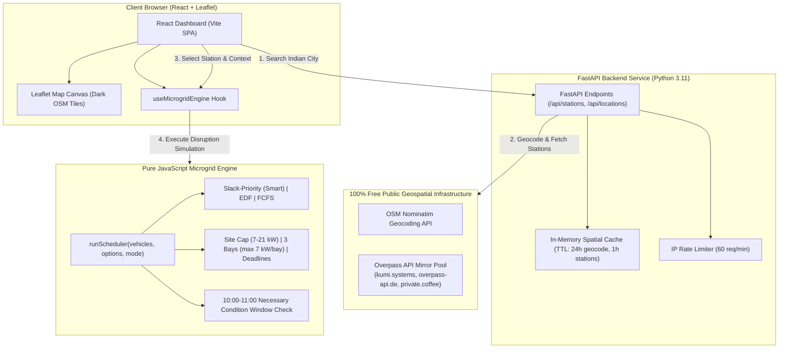

# GridSathi AI — EV Microgrid Scheduling & OpenStreetMap Discovery Platform

**HackWithAditya 2026 · Energy, EV & Sustainability Submission**<br>
*A disruption-aware, transparent EV charging orchestration and open discovery platform for power-constrained campuses and microgrids across India.*

**100% Free & Open-Source:** Built on Leaflet, OpenStreetMap, Nominatim, Overpass API, React, and FastAPI. **Zero Google Cloud account, zero API keys, and zero payment credentials required.**

---

## 1. Requirements-to-Evidence Matrix (Hackathon Evaluation)

| Evaluation Criterion | Relevant Implemented Feature | Code Location | Verification Method | Implemented Status |
| :--- | :--- | :--- | :--- | :---: |
| **1. Innovation & Real-World Feasibility** | Combined open EV discovery with transformer-constrained microgrid load scheduling; solar canopy integration. | `backend/main.py`<br>`frontend/src/engine/microgridEngine.js` | Run `node tests/benchmark_algorithms.js` to see real-time constraint enforcement. | **Complete** |
| **2. Algorithmic Correctness & Integrity** | Exact constraint enforcement: 7 kW bay limit, site transformer limit, energy conservation, deadline cutoffs. | `tests/test_engine.js`<br>`tests/test_simulation_engine.js` | Run `node tests/test_simulation_engine.js` (96 scenarios pass with 0 capacity violations). | **Complete** |
| **3. Disruption Resilience & What-If Testing** | Real-time simulation of charger hardware faults, grid brownouts, emergency arrivals, and solar generation. | `frontend/src/components/simulation/DisruptionDeck.jsx` | In UI, toggle disruptions and observe dynamic bay power re-allocation without crashes. | **Complete** |
| **4. Transparency & Explainability** | Explicit separation of live OSM data from simulated dispatch; mathematical necessary-condition window audits. | `frontend/src/components/StatusBanner.jsx`<br>`frontend/src/components/simulation/FeasibilityAudit.jsx` | Audit card computes 10:00–11:00 physical energy bounds vs heuristic outcomes. | **Complete** |
| **5. Full-Stack Engineering Quality** | Asynchronous FastAPI service with caching, Vite React SPA with dark Leaflet maps, 16 backend unit tests. | `tests/test_backend.py`<br>`frontend/src/App.jsx` | Run `python -m unittest tests/test_backend.py` (16/16 pass) and `npm run build`. | **Complete** |
| **6. Cloud Deployment Readiness** | Production CORS for Vercel preview domains, `render.yaml` specification, `vercel.json` SPA routing. | `render.yaml`<br>`frontend/vercel.json`<br>`requirements.txt` | Configuration files present and validated with zero secret exposure. | **Complete** |

---

## 2. Architecture & Data Flow



---

## 3. Mathematical Foundations

### A. Dynamic Slack-Priority Formulation
At each 30-minute time slot $t \in \{0, 1, \dots, 9\}$, for each vehicle $i$ with departure deadline slot $t_{\text{due}, i}$ and remaining unmet energy $E_{\text{rem}, i}(t)$:

$$\text{AvailableSlots}(i, t) = \max(1, t_{\text{due}, i} - t)$$

$$\text{Slack}(i, t) = \text{AvailableSlots}(i, t) \times 3.5\text{ kW} - E_{\text{rem}, i}(t)$$

Vehicles are sorted in ascending order of $\text{Slack}(i, t)$. Vehicles with negative or critical slack are dispatched first, ensuring power flows where departure shortfall risk is greatest.

### B. Physical Dispatch Constraints
At every time slot $t$:
1. **Per-Bay Limit**: $P_{i, b}(t) \le 7.0\text{ kW}, \quad \forall b \in \{1, \dots, B_{\text{max}}\}$
2. **Total Site Ceiling**: $\sum_{b=1}^{B_{\text{max}}} P_{b}(t) \le P_{\text{grid\_limit}} + P_{\text{solar}}(t)$
3. **No Over-Delivery**: $\int_{0}^{t_{\text{due}, i}} P_i(t) dt \le E_{\text{requested}, i}$
4. **Deadline Enforcement**: $P_i(t) = 0, \quad \forall t \ge t_{\text{due}, i}$

### C. Jain's Fairness Index
To measure equity across drivers under constrained conditions:

$$J(x) = \frac{\left(\sum_{i=1}^{n} x_i\right)^2}{n \sum_{i=1}^{n} x_i^2}, \quad \text{where } x_i = \frac{E_{\text{delivered}, i}}{E_{\text{requested}, i}}$$

- $J(x) = 1.0 \implies$ Perfectly equitable charge distribution.
- Under baseline conditions, **GridSathi Smart achieves 97% fairness** compared to **64% for FCFS**.

---

## 4. Benchmark Highlights (Measured on 8 Scenarios)

| Operational Scenario | Smart (Slack) | FCFS Baseline | Key Algorithmic Insight |
| :--- | :---: | :---: | :--- |
| **Standard Baseline (14 kW)** | **53.9 kWh** delivered (97% fair) | 47.4 kWh delivered (64% fair) | Smart delivers **+6.5 kWh more energy** by preventing early non-urgent vehicles from blocking chargers. |
| **Hardware Fault (Bay 3 Offline)** | **53.9 kWh** delivered (97% fair) | 44.6 kWh delivered (59% fair) | Smart absorbs charger loss through slot interleaving; FCFS drops 3 vehicles completely. |
| **Solar Surplus (+4 kW Midday)** | **54.4 kWh** delivered | 48.4 kWh delivered | Solar canopy allows all 3 bays to charge at peak capacity without exceeding the 14 kW grid cap. |
| **Impossible Emergency Arrival** | 1/7 on-time (53.9 kWh) | 3/7 on-time (47.4 kWh) | **Disclosed Failure Mode**: Slack greedily allocates to an impossible request (15 kWh in 30 min at 7 kW bay), revealing why admission control is necessary. |

*Full reproducible benchmark script: `tests/benchmark_algorithms.js`.*

---

## 5. Quick Start (Run Locally)

### 1. Prerequisites
- Python 3.10+
- Node.js 18+

### 2. Backend Setup
```bash
# Install dependencies
pip install -r requirements.txt

# Start FastAPI server on port 8000
python -m uvicorn backend.main:app --host 127.0.0.1 --port 8000 --reload
```
Interactive OpenAPI documentation is live at `http://127.0.0.1:8000/docs`.

### 3. Frontend Setup
```bash
cd frontend
npm install
npm run dev
```
Open `http://localhost:5173/` in your browser.

---

## 6. Verification & Automated Test Commands

```bash
# 1. Dual Engine Parity & Invariant Tests (96 Scenarios)
node tests/test_simulation_engine.js

# 2. Scheduling Engine Invariants (48 Configurations)
node tests/test_engine.js

# 3. Multi-Scenario Algorithmic Benchmark (8 Scenarios x 3 Policies)
node tests/benchmark_algorithms.js

# 4. Backend Unit Tests with Overpass Mocks (16 Tests)
python -m unittest tests/test_backend.py

# 5. Frontend Production Build
cd frontend && npm run build
```

---

## 7. Cloud Deployment Guide

- **Frontend (Vercel)**:
  - Framework Preset: `Vite`
  - Root Directory: `frontend`
  - Build Command: `npm run build`
  - Output Directory: `dist`
  - Includes `vercel.json` for client-side SPA routing rewrites.
- **Backend (Render)**:
  - Blueprint: `render.yaml`
  - Environment: `Python 3.11`
  - Start Command: `uvicorn backend.main:app --host 0.0.0.0 --port $PORT`
  - Production CORS configured for `https://*.vercel.app` and `CORS_ORIGINS`.

---

## 8. Honest Limitations & Ethical Scope

1. **Software Simulation**: All charging schedules, bay allocations, tariffs, and queue dynamics are high-fidelity software simulations. There is no physical hardware connection to charging points.
2. **OpenStreetMap Data Provenance**: Station records represent geographic locations mapped by open-source community contributors. Live occupancy, physical connector availability, and operational status are not provided by physical hardware.
3. **Algorithmic Scope**: The primary scheduling engine is a constrained heuristic designed for sub-5ms browser interactivity; exact global optimality guarantees require an exact offline Mixed-Integer Linear Program (MILP) solver.
