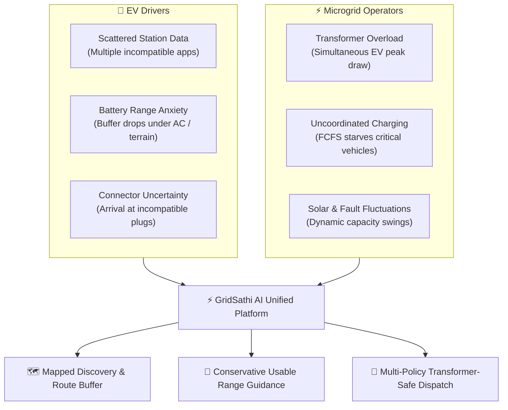
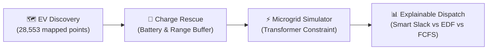
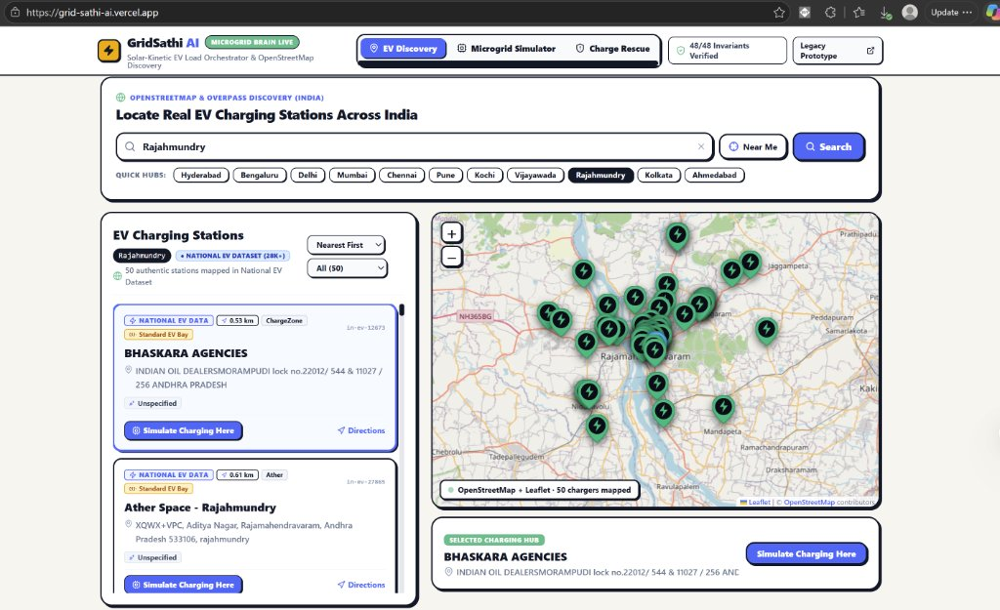
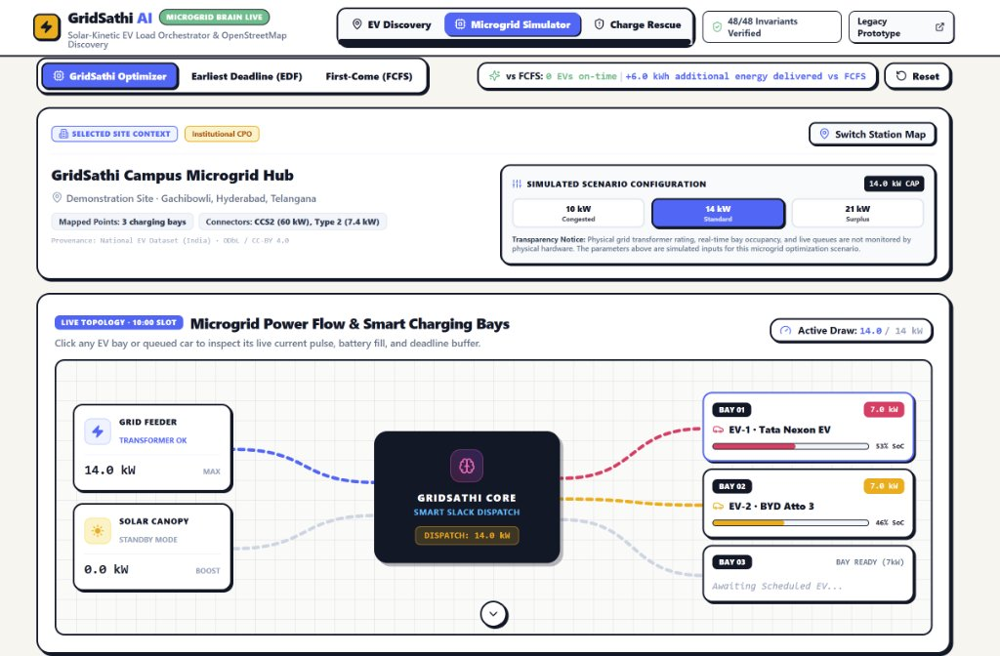
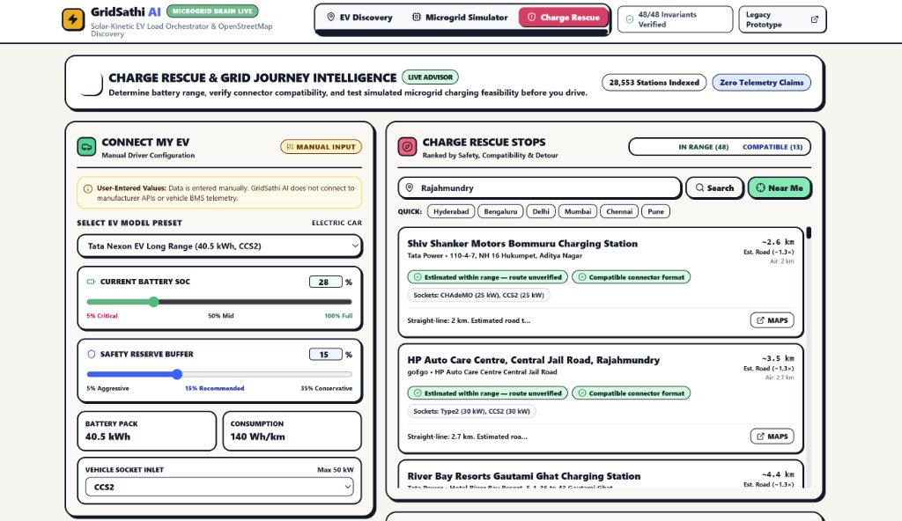
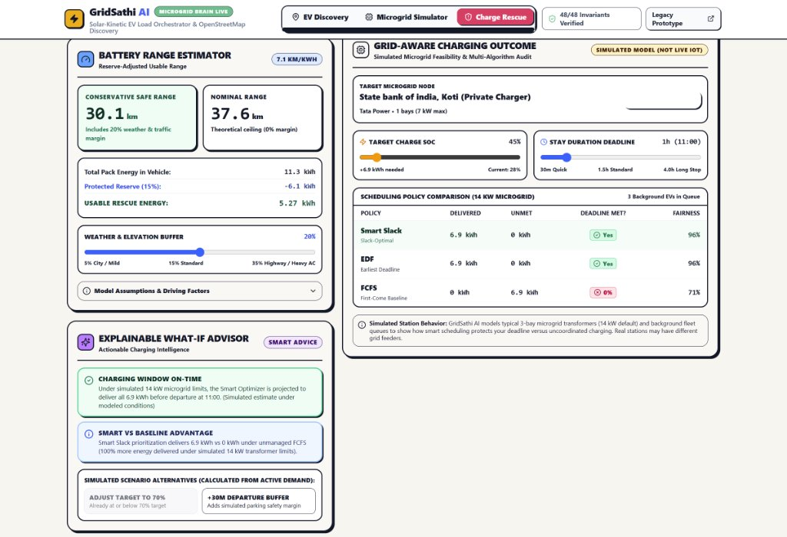

<div align="center">

# ⚡ GridSathi AI
### Discover charging. Plan your range. Optimize the grid.

[](https://opensource.org/licenses/MIT)
[](https://www.openstreetmap.org/)
[](https://react.dev/)
[](https://fastapi.tiangolo.com/)
[](#)

**An intelligent, dual-sided decision-support system connecting EV drivers with nationwide charging infrastructure and microgrid operators with transformer-safe, explainable dispatch.**

[🚀 **Launch Live Demo**](https://grid-sathi-ai.vercel.app/) • [📖 **API Docs**](https://gridsathi-backend.onrender.com/docs) • [💻 **GitHub**](https://github.com/GavaraNeha/GridSathi-AI) • [📚 **Deep Documentation**](docs/)

</div>

---

## 🎯 The Problem in One Glance

Uncoordinated electric vehicle adoption strains both sides of the charging ecosystem:



---

## 🔄 How GridSathi AI Works

GridSathi bridges driver trip planning and microgrid load orchestration in a single continuous workflow:



| Module | What It Does | Key Capabilities |
| :--- | :--- | :--- |
| **🗺️ EV Discovery** | Fast, nationwide charging station discovery across India. | • 28,553 mapped stations indexed in 8,129 spatial buckets (0.1° grid)<br/>• Sub-15 ms bounding-box & Haversine distance search (~117 MB RSS)<br/>• Interactive Leaflet map with city-hub quick filters |
| **🔋 Charge Rescue** | Usable range estimator and station reachability advisor. | • 4 OEM presets (Nexon, Atto 3, Punch, EV6) + custom battery input<br/>• Reserve protection (5%–35%) & weather/elevation penalty modeling<br/>• Connector compatibility check (CCS2, Type 2, GB/T, CHAdeMO) |
| **⚡ Microgrid Simulator** | Transformer-safe EV load scheduling and disruption replay. | • Smart Critical Slack vs EDF vs FCFS policy benchmarking<br/>• Hard physical transformer limit (10 kW congested / 14 kW / 21 kW)<br/>• Solar canopy feed, bay fault trips, and Jain's fairness index |

---

## 📸 See It in Action

| 🗺️ 1. Locate Real Charging Stations | ⚡ 2. Microgrid Power Flow Topology |
| :---: | :---: |
| [](screenshots/01-ev-discovery.png) | [](screenshots/02-microgrid-simulator.png) |
| *Nationwide station discovery across India backed by OpenStreetMap data.* | *Interactive simulated power-flow topology and transformer-safe dispatch.* |

| 🔋 3. Configure Battery & Find Stops | 📊 4. Usable Range & What-If Guidance |
| :---: | :---: |
| [](screenshots/03-charge-rescue.png) | [](screenshots/04-charge-rescue-results.png) |
| *Manual vehicle presets, battery SOC buffer, and compatible station filters.* | *Reserve-adjusted usable range (30.1 km conservative at 20% buffer) and What-If audit.* |

---

## ✨ Why GridSathi AI Is Different

- **Dual-Sided Co-Design**: Unlike single-purpose navigation apps or standalone utility dispatch tools, GridSathi connects driver journey decisions directly to microgrid hosting constraints.
- **Defensive Range Buffering**: Protects a dedicated battery reserve buffer (15% default) so drivers never plan to arrive at 0% SOC, factoring in a 1.3× road circuity multiplier.
- **Physical Transformer Protection**: Strict zero-tolerance hard constraint prevents transformer over-subscription regardless of incoming fleet volume or concurrent fast-charging demand.
- **Transparent Multi-Policy Benchmarking**: Directly compares Smart Critical Slack, Earliest Deadline First (EDF), and First-Come First-Served (FCFS) in real time with side-by-side metrics.
- **Real-World Disruption Replay**: Simulates sudden bay hardware trips and solar drop-offs with automatic dynamic bay reassignment.
- **Open Data & Zero Hardware Lock-in**: Powered by OpenStreetMap (ODbL) with pure client-side simulation engines for instant in-browser evaluation without hardware lock-in.

---

## ⚖️ GridSathi vs Existing Solutions

| Dimension | Commercial Discovery (e.g., PlugShare) | Commercial CMS (e.g., ChargePoint, AMPECO) | Academic Solvers (CPLEX / Gurobi LP) | ⚡ GridSathi AI |
| :--- | :--- | :--- | :--- | :--- |
| **Primary Audience** | EV Drivers only | CPOs / Fleet Operators | Researchers & Theorists | **Drivers & Microgrid Operators** |
| **Grid Constraint Modeling** | ❌ None (assumes infinite grid) | ✅ Real hardware telemetry (proprietary) | ✅ Exact mathematical models (offline) | ✅ **Live client-side transformer limits** |
| **Range & Battery Buffer** | ⚠️ Generic EPA / WLTP range | ❌ Not in scope | ❌ Not in scope | ✅ **Reserve-protected usable range** |
| **Multi-Policy Transparency** | ❌ None | ⚠️ Black-box proprietary rules | ⚠️ Code/Math only (no user UI) | ✅ **Side-by-side Smart vs EDF vs FCFS** |
| **Hardware / IoT Requirements** | ❌ None | 🔒 Requires dedicated smart chargers | 🔒 Requires commercial solver licenses | 🌐 **Zero setup (runs in any browser)** |

> *Note: Commercial CMS solutions excel in live OCPP telemetry, billing, and physical hardware control. GridSathi AI provides an accessible, open-access decision-support and educational simulation layer.*

---

## 📊 Measurable Results

In our standardized baseline scenario (6 EVs, 3 charging bays, 14 kW transformer capacity, 68.26 kWh requested energy over 10 hours):

| Metric | 🧠 Smart Critical Slack | ⏱️ Earliest Deadline (EDF) | 🚶 First-Come First-Served (FCFS) | 📐 LP Upper Bound |
| :--- | :---: | :---: | :---: | :---: |
| **Delivered Energy** | **53.40 kWh** (+12.7% vs FCFS) | **53.90 kWh** (+13.7% vs FCFS) | 47.40 kWh (baseline) | 53.90 kWh (relaxation) |
| **On-Time Vehicles** | **3 / 6 EVs** (100% of feasible) | **3 / 6 EVs** (100% of feasible) | 3 / 6 EVs (100% of feasible) | 3 / 6 EVs |
| **Transformer Violations** | **0 kW** (100% compliant) | **0 kW** (100% compliant) | **0 kW** (100% compliant) | 0 kW |
| **Jain's Fairness Index** | **0.96** (balanced allocation) | **0.96** (balanced allocation) | 0.71 (severe starvation) | — |

*Results reflect the baseline 6-EV scenario. In congested scenarios, Smart Slack prioritizes vehicles with the tightest deadline buffers, preventing emergency starvation while strictly enforcing grid feeder limits. See the full 8-scenario benchmark matrix in [docs/BENCHMARKS.md](docs/BENCHMARKS.md).*

---

## ⏱️ Try It Yourself in 60 Seconds

Experience the full loop right in your browser (no account or installation required):

1. **Find a Station**: Go to [EV Discovery](https://grid-sathi-ai.vercel.app/), select a hub (e.g., *Hyderabad* or *Rajahmundry*), and click **Simulate Charging Here**.
2. **Configure Range**: Switch to **Charge Rescue**, pick your vehicle preset (*Tata Nexon EV*), set battery SOC to `28%`, and review your safe usable range (*30.1 km* with 20% weather margin).
3. **Dispatch Microgrid**: Switch to **Microgrid Simulator**, select **GridSathi Optimizer**, toggle transformer limits (*10 kW / 14 kW / 21 kW*), and observe power reallocation with zero grid overages.

👉 [**Open GridSathi AI Live Demo**](https://grid-sathi-ai.vercel.app/)

---

## 🛠️ Built With

| Layer | Technologies & Tools | Role in GridSathi AI |
| :--- | :--- | :--- |
| **Frontend** | React 19, Vite 6, Tailwind CSS | High-performance, responsive UI with light neo-brutalist styling |
| **Interactive Maps** | Leaflet, OpenStreetMap | Client-side map rendering, custom marker clusters, station cards |
| **Backend API** | FastAPI, Python 3.11, Uvicorn | 0.1° spatial indexing across 28,553 mapped points (~117 MB RSS, ~15 ms query) |
| **Client Engines** | Pure JavaScript (`microgridEngine.js`, `journeyEngine.js`) | Zero-latency browser execution of dispatch algorithms and range math |
| **Cloud Hosting** | Vercel (Frontend), Render (Backend) | Continuous deployment with automated health check probes |

---

## 🌐 Real-World Relevance

| User / Stakeholder | How GridSathi AI Solves Their Pain |
| :--- | :--- |
| 🎓 **University & Corporate Campuses** | Manages employee EV charging under fixed substation capacity without expensive transformer upgrades. |
| 🚚 **Commercial Fleet Hubs** | Schedules delivery vans with strict departure deadlines while avoiding utility peak-demand surcharges. |
| 🏨 **Hotels, Malls & Public Parking** | Allocates limited grid power dynamically across destination chargers based on guest dwell times. |
| 🔬 **Researchers & Policy Planners** | Open benchmark environment to test and compare EV coordination algorithms against real open data. |
| 🚗 **Everyday EV Drivers** | Eliminates range anxiety with reserve-protected reachability and connector compatibility checks. |

---

## 🔍 What Is Real, Estimated, and Simulated?

To maintain scientific integrity and transparency, GridSathi AI clearly distinguishes data sources:

| Category | Status | Details |
| :--- | :---: | :--- |
| **Station Coordinates & Metadata** | 🟢 **Real Open Data** | 28,553 station records extracted from OpenStreetMap under ODbL / CC-BY 4.0. |
| **Usable Range & Detour Distance** | 🟡 **Estimated Model** | Physics-based consumption ($140\text{ Wh/km}$), user buffers, and $1.3\times$ circuity factor; road routing unverified. |
| **Microgrid Power & Queue Dispatch** | 🔵 **Simulated Model** | Deterministic discrete-event simulation ($0.5\text{h}$ slots); not connected to physical IoT meters or live bay sensors. |

*GridSathi AI is a functional software prototype for decision support and planning. Real-world physical deployment would require OCPP 1.6J/2.0.1 charge point management and smart meter integrations.*

---

## 📚 Deep Technical Documentation

Comprehensive engineering reports, algorithm proofs, benchmarks, and deployment guides are available in the [`docs/`](docs/) directory:

- 📖 [**Project Overview & Impact**](docs/PROJECT_OVERVIEW.md) — Problem statement, market relevance, and hackathon requirements matrix.
- 🏗️ [**System Architecture**](docs/ARCHITECTURE.md) — End-to-end data pipelines, spatial indexing, and frontend architecture.
- 🧠 [**Algorithmic Formulation**](docs/ALGORITHMS.md) — Feasibility-aware critical slack math, LP relaxation upper bound, and constraints.
- 📊 [**Benchmark Evaluation**](docs/BENCHMARKS.md) — 8-scenario benchmark suite, fairness metrics, and reproduction instructions.
- ⚖️ [**Competitive Positioning**](docs/COMPETITIVE_POSITIONING.md) — Detailed comparison against commercial CMS and open solvers.
- 🚀 [**Setup & Deployment Guide**](docs/SETUP_AND_DEPLOYMENT.md) — Step-by-step local development setup and cloud deployment instructions.
- 🛡️ [**Validation & Operational Boundaries**](docs/VALIDATION_AND_LIMITATIONS.md) — Full transparency matrix, hardware requirements, and future roadmap.

---

## ⚡ Local Quick Start

Run GridSathi AI locally in 2 minutes:

```bash
# 1. Clone repository
git clone https://github.com/GavaraNeha/GridSathi-AI.git && cd GridSathi-AI

# 2. Start Backend (Terminal 1)
pip install -r backend/requirements.txt
uvicorn backend.main:app --port 8000 --reload

# 3. Start Frontend (Terminal 2)
cd frontend && npm install && npm run dev
```

Visit `http://localhost:5173` to explore the application locally.

---

## 📜 License & Attribution

- **Source Code**: Released under the [MIT License](https://opensource.org/licenses/MIT).
- **Charging Station Data**: © [OpenStreetMap contributors](https://www.openstreetmap.org/copyright), licensed under the [Open Database License (ODbL)](https://opendatacommons.org/licenses/odbl/).
- **Created for**: **HackWithAditya 2026** — *Track 04: Energy, EV & Sustainability*.
