# GridSathi AI — Architecture & Data Flow

This document details the system architecture, component relationships, data flow pipelines, and indexing structures of GridSathi AI.

---

## 1. End-to-End System Architecture

```mermaid
flowchart TD
    subgraph Client["Client Browser (React 19 + Vite 6 SPA — Light Neo-Brutalist)"]
        Nav["Tri-View Navigation Tabs (App.jsx)"]
        DiscoveryTab["EV Discovery View"]
        RescueTab["Charge Rescue View"]
        SimulatorTab["Microgrid Simulator View"]

        subgraph DiscoveryView["Module 1: EV Discovery"]
            SearchBar["SearchBar & City Selector"]
            LeafletMap["Leaflet Map Canvas (CartoDB Voyager Light)"]
            StationList["StationList & StationCards"]
        end

        subgraph RescueView["Module 2: Charge Rescue"]
            ProfileCard["VehicleProfileCard (10 Indian Presets)"]
            RangeCard["BatteryRangeCard (Safe vs. Nominal Range)"]
            RescueFinder["StationRescueFinder (Detour & Compatibility)"]
            WhatIfCard["WhatIfAdvisor (Dynamic Decision Cards)"]
            GridRescueSim["GridRescueSimulator (Outcome Evaluator)"]
        end

        subgraph SimView["Module 3: Microgrid Simulator"]
            HeaderBar["HeaderBar (Smart / EDF / FCFS Switcher & vs FCFS Pill)"]
            SiteBanner["SiteContextBanner (Station Context Transfer)"]
            Topology["MicrogridTopology (Live Power Flow)"]
            LoadChart["LoadProfileChart (Power Curve & Grid Ceiling)"]
            Ribbon["ScheduleRibbon (10-Slot Multi-Track Timeline)"]
            DisruptionDeck["DisruptionDeck (Fault, Brownout, Solar, Emergency)"]
            AuditCard["FeasibilityAudit (Engineering Feasibility Analysis)"]
            FleetTable["FleetInspector (Individual EV Session Audit)"]
        end

        Nav --> DiscoveryTab & RescueTab & SimulatorTab
        DiscoveryTab --> SearchBar & LeafletMap & StationList
        RescueTab --> ProfileCard & RangeCard & RescueFinder & WhatIfCard & GridRescueSim
        SimulatorTab --> HeaderBar & SiteBanner & Topology & LoadChart & Ribbon & DisruptionDeck & AuditCard & FleetTable
    end

    subgraph ClientEngines["Deterministic Client-Side Engines (Zero Network Overhead)"]
        JourneyEngine["journeyEngine.js<br>• Battery Range & Usable Energy Math<br>• 1.30x Circuity Distance Math<br>• Truthful Connector Format Audit<br>• Candidate Ranking & Detour Scoring<br>• What-If Advice Generator"]
        MicrogridEngine["microgridEngine.js<br>• runScheduler(vehicles, options, mode)<br>• Smart Slack (Critical Feasible Priority)<br>• Earliest Deadline First (EDF)<br>• First-Come, First-Served (FCFS)<br>• Jain's Fairness Index & Energy Conservation"]
    end

    subgraph BackendService["FastAPI Backend Service (Python 3.11 on Render)"]
        APIEndpoints["FastAPI Endpoints<br>• /api/health (28,553 Station Count)<br>• /api/config (Attribution & Rate Limits)<br>• /api/stations (Proximity & City Search)<br>• /api/locations (Autocomplete Suggestions)"]
        SpatialGrid["0.1° Spatial Grid Index<br>(8,129 Bounding-Box Buckets)"]
        DatasetStore["In-Memory Dataset<br>(28,553 Authentic Stations in India)"]
        CacheMgr["Disk & In-Memory TTL Cache<br>(24h Geocodes, 1h Overpass)"]
        RateLimiter["IP Rate Limiter (60 req/min)"]
    end

    subgraph PublicGeospatial["100% Free Public Geospatial Infrastructure"]
        Nominatim["OSM Nominatim Geocoding API"]
        OverpassPool["Global Overpass API Mirrors (kumi.systems, overpass-api.de, private.coffee)"]
    end

    SearchBar -- "1. Search City or GPS Near Me" --> APIEndpoints
    APIEndpoints --> SpatialGrid --> DatasetStore
    APIEndpoints -- "Fallback if unmapped" --> Nominatim & OverpassPool
    StationList -- "2. Simulate Charging Here" --> SiteBanner
    ProfileCard & RangeCard --> JourneyEngine
    RescueFinder & WhatIfCard --> JourneyEngine
    JourneyEngine -- "Inject Simulated Rescue EV" --> MicrogridEngine
    SimulatorTab --> MicrogridEngine
```

---

## 2. Spatial Grid Indexing (Backend)

The FastAPI backend indexes **28,553 authentic mapped charging stations** across 4,251 Indian cities and towns using an in-memory 0.1° spatial hashing grid:

* **Bucket Resolution:** $0.1^\circ \times 0.1^\circ$ (approximately $11.1\text{ km} \times 11.1\text{ km}$ at India's latitude).
* **Partition Scale:** 8,129 active spatial buckets populated at startup in ~1.2 seconds.
* **Proximity Query Complexity:** Given a user coordinate $(\text{lat}, \text{lon})$ and search radius $R$:
  $$\Delta \text{lat} = \frac{R}{111.0}, \quad \Delta \text{lon} = \frac{R}{111.0 \times \cos(\text{lat}_{\text{rad}})}$$
  The query inspects only the intersecting spatial buckets rather than scanning all 28,553 stations, filtering candidate records using the exact Haversine metric in ~15 ms with ~117 MB RSS memory usage.

---

## 3. Client-Side Deterministic Engines

All journey planning and microgrid scheduling logic executes purely client-side within the browser V8 runtime, guaranteeing sub-2ms responsiveness with zero API rate limits or backend roundtrips during interactive slider adjustments:

1. **`journeyEngine.js`**:
   * Evaluates usable energy: $E_{\text{usable}} = \text{Capacity} \times \max(0, \text{SOC} - \text{Reserve}) / 100$.
   * Computes nominal distance ($E_{\text{usable}} / \text{Consumption}$) and conservative safe distance ($D_{\text{nominal}} \times (1 - \text{Buffer})$).
   * Models 1.30× empirical Haversine circuity for road travel distance estimates.
   * Audits physical socket matching (CCS2, Type 2, 3-pin/15A, Bharat AC-001, Type6, CHAdeMO, GB/T).
   * Generates dynamic What-If advice cards based on active battery shortfall and dwell time.

2. **`microgridEngine.js`**:
   * Simulates 10 discrete half-hour time slots ($t \in \{0, \dots, 9\}$).
   * Enforces 7 kW per-bay caps, 14 kW site transformer limit, and midday solar canopy generation.
   * Concurrently computes **Smart Critical Slack**, **Earliest Deadline First (EDF)**, and **First-Come, First-Served (FCFS)** schedules.
   * Calculates Jain's Fairness Index, aggregate costs, and unmet energy deficits.

---

## 4. UI Architecture & Design System

The frontend is constructed with React 19, Vite 6, and Tailwind CSS using a **Light Neo-Brutalist** aesthetic:

* **Visual Identity:** High-contrast ink-black borders (`border-2 border-[#111827]`), a warm cream canvas (`#F7F5F0`), crisp tactile drop-shadows (`shadow-[3px_3px_0px_#111827]`), and bright functional color accents (`#4163F5` Indigo, `#55BD8D` Emerald, `#F5AD16` Amber, `#E83D62` Crimson).
* **Cross-Tab Continuity (`SiteContextBanner.jsx`):** When clicking *"Simulate Charging Here"* on any station card or map popup, station coordinates, CPO name, socket types, and bay ratings are transferred directly into the Microgrid Simulator state, automatically seeding the microgrid header and contextualizing the simulation.
* **Dynamic Benchmark Comparison (`HeaderBar.jsx`):** Dynamically computes live deltas against the unmanaged FCFS baseline (`vs FCFS: 0 EVs on-time | +6.0 kWh additional energy delivered vs FCFS`) with zero hardcoded values.
* **Engineering Feasibility Audit (`FeasibilityAudit.jsx`):** Dynamically breaks down shortfalls into physical transformer limits, vehicle onboard charger limits, and departure deadline contention.

---

## Related Documentation
* [Project Overview & Requirements](PROJECT_OVERVIEW.md)
* [Algorithms & Mathematical Formulations](ALGORITHMS.md)
* [Empirical Performance Benchmarks](BENCHMARKS.md)
* [Competitive Positioning](COMPETITIVE_POSITIONING.md)
* [Local Setup & Cloud Deployment Guide](SETUP_AND_DEPLOYMENT.md)
* [Validation, Transparency Matrix & Limitations](VALIDATION_AND_LIMITATIONS.md)
